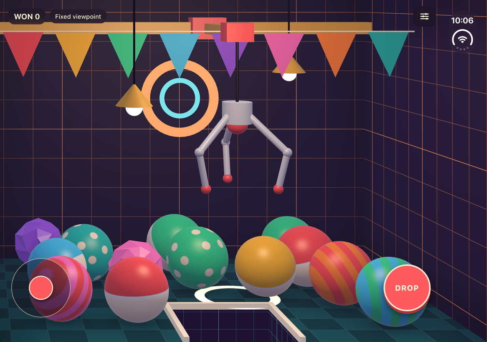
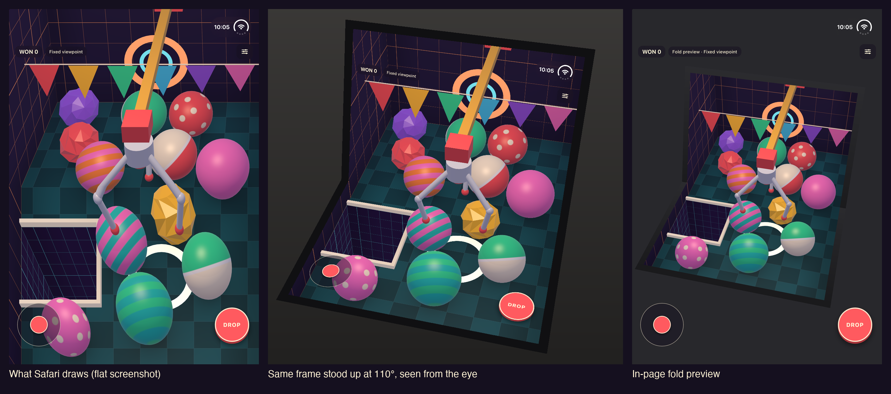

# Diorama Crane for Safari

A claw machine you look into: the picture is redrawn for where your eyes are, so the cabinet
behaves like a real box behind the glass. This is the web version of a native iPhone Duo app: no
Xcode, no developer account, nothing to install. It is a folder of static files with no build step.

**Play it: <https://scasella.github.io/diorama-crane/>**

(This folder is published on its own. `Tools/`, `Tests/` and `dev/` mentioned below belong to
the full project and are not part of the published copy.)



## Try it

In the iPhone Duo Simulator, or any desktop browser:

```sh
python3 Tools/serve.py
```

then open `http://localhost:8417/` in Safari. The Simulator reaches your Mac at `localhost`:

```sh
xcrun simctl openurl booted http://localhost:8417/
```

## On a real iPhone Duo

A phone needs the page on an **https** address. Browsers give a page the camera only on https
(or `localhost`), so `http://<your-Mac's-address>:8417` will show the game but refuse head
tracking. This copy is served by GitHub Pages; any other static host works too, because every
link in the page is relative.

In Safari on the phone:

1. Open <https://scasella.github.io/diorama-crane/>.
2. Share → **Add to Home Screen**, and start it from the icon. That runs it full screen, which
   is how it is meant to be used: Safari has no full-screen mode for pages on iPhone.
3. Open the menu (top right) and switch on **Head tracking with camera**.

The bottom of the menu shows which build is running. A phone can hold on to an older copy for a
while after an update; close the Home Screen app and open it again to pick up a new one.

[probe.html](https://scasella.github.io/diorama-crane/probe.html) lists what the browser exposes
(fold, graphics, camera). The Simulator's Safari reports no fold information at all; a real
phone may differ, and that page is how to find out.

## What Safari cannot tell a page

Measured with `probe.html` in the iPhone Duo Simulator (Safari 27):

| The native app gets | A page in Safari gets |
| --- | --- |
| Hinge angle, live | Nothing. No posture, no angle, no fold position. |
| A view covering the whole screen | A viewport 80 pt or more shorter, below the toolbar |
| The camera's field of view | Nothing; it is assumed |
| A built-in face detector | None; a model is loaded from the network |

So the web version asks you for what it cannot measure:

- **Device is folded** and **Hinge angle** in the menu. Flat is the default. Set the angle
  until the grid lines run straight across the fold. It is remembered.
- **Fold line** nudges where the page thinks the fold is, one point at a time, with a guide
  line while you adjust. The page works it out from the window: the fold runs through the
  middle of the screen's long side, and Safari's toolbar is above the page. From the Home
  Screen the page covers the screen and the fold is its midline.
- **Viewing distance** scales the measured distance to your eyes, since the camera's field of
  view is a guess (68° along the long side). Direction does not depend on it, only depth.

A screenshot of a folded Duo looks bent, because each half is drawn for the angle it is really
seen at. Left: what Safari draws. Middle: the same frame stood up at the hinge angle and
photographed from the eye by `Tools/fold_preview.py`. Right: the page's own **Fold preview**,
for looking at a fold on a flat screen.



## Head tracking

The front camera feeds Google's MediaPipe face-landmark model, which runs in the page. Frames
are analysed on the device and dropped; nothing is uploaded. The model and its library are
fetched the first time head tracking is switched on, from `cdn.jsdelivr.net` (code, about
15 MB) and `storage.googleapis.com` (model, 3.8 MB); the URLs are at the top of
`js/tracker.js` if you would rather host them yourself.

Without the camera the view follows a drag, and sweeps slowly when left alone.

## Options in the address

For repeatable runs. Example: `?fold=110&eyeAz=-20&eyeEl=8&demo=0`

| Option | Effect |
| --- | --- |
| `fold=110` | Folded at this hinge angle (degrees); `fold=0` for flat |
| `foldPos=395.5` | Fold position in the viewport, in points, instead of the computed one |
| `eyeAz`, `eyeEl`, `eyeDist` | Pin the viewpoint (degrees, degrees, distance scale) |
| `demo=0`, `autoplay=0` | No automatic sweep, no self-play |
| `stereo=anaglyph` | Red/cyan glasses |
| `foldPreview=1` | Show a folded device as the eye sees it (for flat screens) |
| `camera=1` | Start head tracking at once |
| `delegate=cpu` | Run the face model on the CPU, if the GPU path misbehaves on a device |
| `hud=0`, `seed=7`, `scale=0.8`, `msaa=0` | No controls; prize layout; render scale; no anti-aliasing |
| `markers=1`, `empty=1`, `dump=1` | Test markers; empty cabinet; report each frame to `Tools/serve.py` |
| `reset=1` | Forget saved settings |

## Checks

```sh
Tests/web/run.sh
```

- **Against the native code.** The Swift projection and rig code print reference results for
  176 display arrangements; the JavaScript port matches all 14,907 numbers.
- **Geometry.** 68,857 assertions, including folds away from the viewport's midline.
- **Game logic.** The cabinet plays itself for four simulated minutes in seven cabinet shapes:
  it never stalls, never empties, and nothing leaves the box.

In Safari in the Simulator, magenta markers in real screenshots against independently computed
sightlines (`Tools/shoot_web.sh`, `Tools/verify_markers.py`). Worst error per posture:

| Posture | In a Safari tab | From the Home Screen |
| --- | --- | --- |
| Flat, portrait and landscape | 0.14 px | 0.14 px |
| Book fold, 123° and 138° | 0.29 px | 0.26 px |
| Laptop fold, 76°, 104° and 138° | 3.0 px | 3.0 px |
| Red/cyan, each eye | 0.4 px, depth sign correct | |

(The 3 px cases are a test dot cut in two by the fold; dots clear of it are within 1.2 px.
Dots that overlap each other, run off the edge of the screen, or sit under the system clock are
left out.)
In the laptop fold the two halves meet on screenshot row 1427; the screen's midline is 1426.5.

The reduced-resolution path a slower phone would fall back to (`scale=0.7`, `scale=0.6`) stays
within 0.6 px. On the closed outer screen the page draws one flat pane even with "Device is
folded" saved; the two test dots clear of the others there are within 0.1 px.

Also exercised by touch in Safari in the Simulator: the stick both ways, an aimed grab that
scores once and is replaced, drag-to-look, double-tap recenter, the menu, the fold switch, the
hinge slider and the fold-line nudge. Frame rate holds at 60 fps at full resolution
(2007 x 2853) in every posture.

`dev/tracker.html` feeds the head tracker a synthetic camera (a sample portrait moved around a
canvas and captured as video; the portrait is a sample image fetched from the MediaPipe
project's site). In Safari in the Simulator it finds the face in about a second, takes about
15 ms a frame on the GPU and 32 ms on the CPU, and reports sideways and vertical movement in the right direction to
within 1 mm and distance to within 1%. The camera permission prompt, stream start-up and model
load also ran in the Home Screen app, against the Simulator's blank camera.

## Not verified

- **A real camera.** Whether Safari delivers frames mirrored or rotated on this phone, and the
  true field of view, are assumptions. *Flip left/right*, *Flip up/down* and *Viewing distance*
  in the menu correct them without touching the code.
- **A real fold.** The hinge angle is whatever you set, and the fold position rests on the
  Simulator's numbers for where Safari puts the page.
- **Physical scale.** 460 ppi is assumed (`?ppi=` overrides it).
- **Performance on hardware.** The page steps its resolution down by itself if frames run slow.
- **Arrow keys in Safari on the phone.** Key presses sent to the Simulator never reached the
  page, in a tab or from the Home Screen. They work in a desktop browser.

## Layout

```
web/
  index.html, style.css, manifest.webmanifest, icons/
  js/
    math.js, projection.js, rig.js, filters.js   the same geometry as the native Core/
    world.js                                     cabinet, prizes, claw, physics
    meshes.js, shaders.js, renderer.js           WebGL2
    eye.js, tracker.js                           viewpoint; camera eye tracking
    hud.js, main.js                              controls; set-up and frame loop
  dev/tracker.html                               head-tracker test
  probe.html                                     what does this browser expose?
Tests/web/                                       projection, rig and game-logic tests
Tools/serve.py, shoot_web.sh, make_icons.py      dev server, screenshots, icons
```
